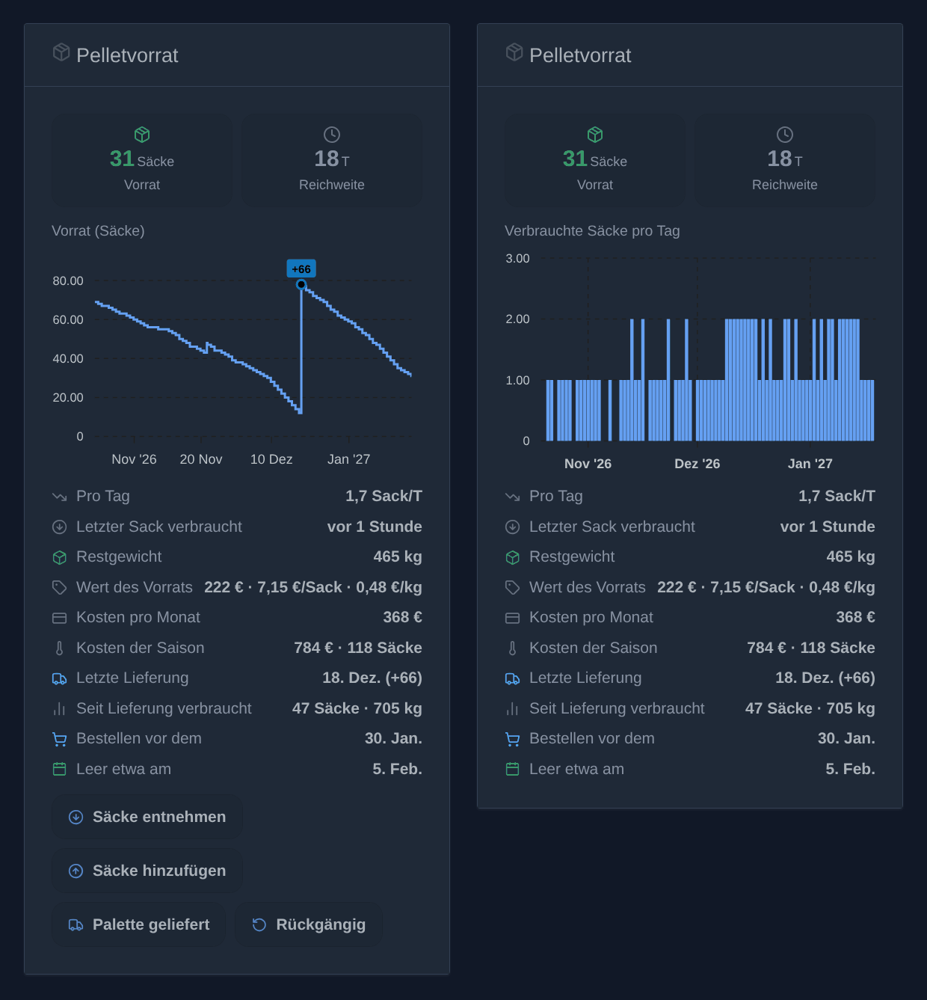
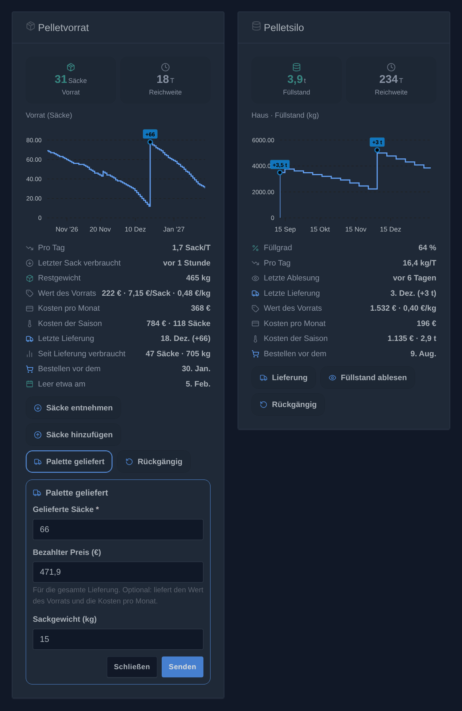
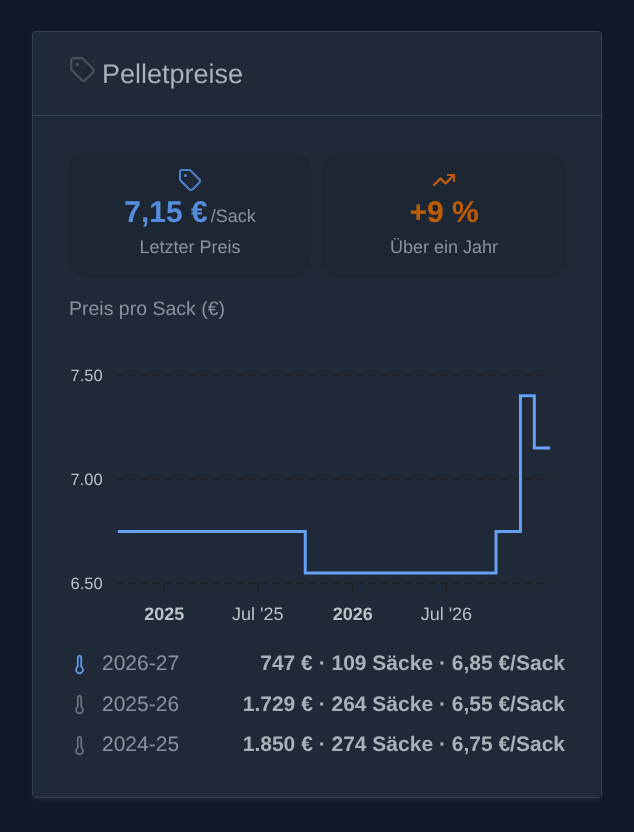
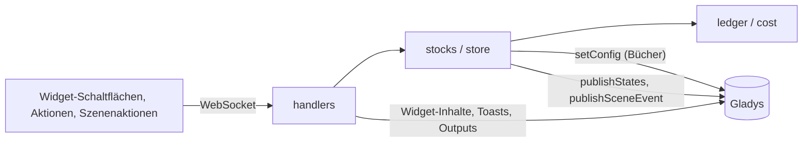
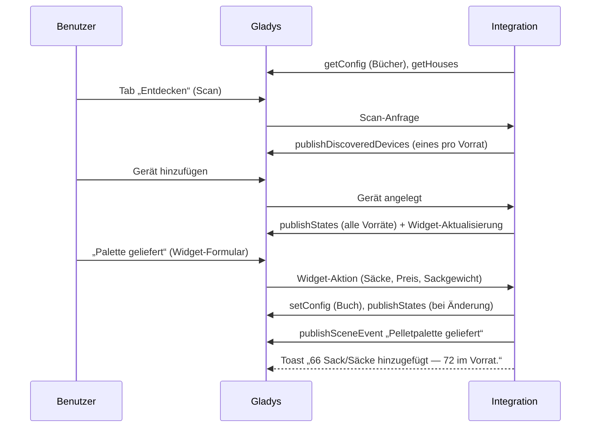
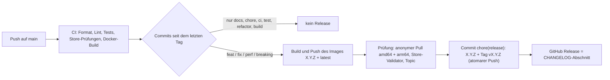

# Gladys Pellet Stock

[English](README.md) · [Français](README.fr.md) · **Deutsch** · [Español](README.es.md)

[](LICENSE)
[](https://github.com/William-De71/gladys-pellet-stock/releases)
[](https://github.com/William-De71/gladys-pellet-stock/actions/workflows/release.yml)
[](https://gladysassistant.com)


Externe Integration für [Gladys Assistant](https://gladysassistant.com), die einen **Pelletvorrat** verfolgt, in
Säcken oder in einem Silo mit losen Pellets, einen pro Haus: Lieferungen, Verbrauch, durchschnittlicher
Tagesverbrauch, Reichweite und Heizkosten, mit **Dashboard-Widgets**, Szenenaktionen und Szenenauslösern, gebaut auf
`@gladysassistant/integration-sdk` 0.15.

Weder Hardware noch Online-Konto: Die Integration führt ein Buch über die Bewegungen und leitet alles daraus ab.







_Erzeugte Illustrationen, keine Bildschirmfotos: Die Inhalte stammen aus dem Code der Integration und sind wie die Widgets von Gladys gezeichnet (dunkler Modus). Der Vorrat im Zeitverlauf mit seinen Schaltflächen und die verbrauchten Säcke pro Tag mit ausgeblendeten Schaltflächen; darunter das Formular „Palette geliefert“ und ein Silo._

Benutzerdokumentation: [English](docs/en.md) · [Français](docs/fr.md) · [Deutsch](docs/de.md) ·
[Español](docs/es.md).

## Inhalt

- [Funktionen](#funktionen)
- [Architektur](#architektur)
- [Installation](#installation)
- [Konfiguration](#konfiguration)
- [Wie die Zahlen berechnet werden](#wie-die-zahlen-berechnet-werden)
- [Entwicklung](#entwicklung)
- [Release und Commit-Konvention](#release-und-commit-konvention)
- [Fehlerbehebung](#fehlerbehebung)
- [Mitwirken](#mitwirken)
- [Lizenz](#lizenz)

## Funktionen

### Dashboard-Widgets

**„Pelletvorrat“** (Säcke):

- **Kacheln**: der Vorrat in Säcken (grün, orange unter der Schwelle für niedrigen Vorrat, rot bei null) und die
  Reichweite in Tagen.
- **Diagramm**, pro Widget gewählt: der **Vorrat im Zeitverlauf** (Stufenlinie, Lieferungen markiert) oder die
  **verbrauchten Säcke pro Tag** (Balken; wöchentlich über ein Jahr). Zeitraum: 1 Monat, 3 Monate oder 1 Jahr.
- **Statuszeilen**: Säcke pro Tag, letzter verbrauchter Sack („vor 2 Stunden“), Restgewicht, Wert des Vorrats mit
  Preis pro Sack und pro kg, Kosten pro Monat und Kosten der Saison (sobald ein Preis bekannt ist), letzte Lieferung
  und seitdem verbrauchte Säcke, das Datum, vor dem bestellt werden sollte, und das voraussichtliche Leerdatum.
- **Schaltflächen**: **Säcke entnehmen** (ein Formular für die Säcke), **Säcke hinzufügen** (die Säcke und der Preis
  pro Sack), **Palette geliefert** (die Säcke, der bezahlte Preis und das Sackgewicht) und **Rückgängig**. Sie lassen
  sich pro Widget ausblenden, für eine reine Wandanzeige.

**„Pelletpreise“** (Säcke oder Silo, schreibgeschützt): der zuletzt bezahlte Preis und seine Entwicklung über ein
Jahr, eine Stufenlinie des Preises pro Sack (pro Tonne bei einem Silo) über 1, 3 oder 5 Jahre und eine Zeile pro
Heizsaison, die laufende in Blau: was die verbrauchten Pellets gekostet haben (first in, first out), wie viele, und
der Durchschnittspreis eines Sacks.

**„Pelletsilo“** (lose): Füllstand, Reichweite, Diagramm des Füllstands oder der kg pro Tag, Füllgrad, letzte
Ablesung, Wert und Preis pro kg, Kosten der Saison, Bestelldatum; **Lieferung**, **Füllstand ablesen** (in kg oder in
% der Kapazität) und **Rückgängig**.

### Geräte

Ein virtuelles Gerät pro Vorrat, im Tab „Entdecken“ angeboten (optional), alle Funktionen schreibgeschützt mit
Verlauf:

| Gerät                 | Funktion           | Kategorie / Typ                         | Einheit / Grenzen |
| --------------------- | ------------------ | --------------------------------------- | ----------------- |
| Pelletvorrat (– Haus) | Pelletvorrat       | `counter-sensor` / `integer`            | 0–10.000 Säcke    |
|                       | Pellet-Reichweite  | `duration` / `integer`                  | Tage, 0–3.650     |
| Pelletsilo – Haus     | Silofüllstand (kg) | `counter-sensor` / `integer`            | 0–100.000 kg      |
|                       | Silo-Füllgrad      | `level-sensor` / `liquid-level-percent` | %, 0–100          |
|                       | Silo-Reichweite    | `duration` / `integer`                  | Tage, 0–3.650     |

Externe IDs: `ext:<selector>:pellet:stock` für den Hauptvorrat, `ext:<selector>:pellet:<haus>:<bags|bulk>` für einen
für ein Haus hinzugefügten Vorrat. Eine unbekannte Reichweite wird nie als 0 veröffentlicht (eine 0 würde die
„leer“-Szenen auslösen).

### Mehrere Häuser

**„Vorrat hinzufügen“** legt einen Vorrat für ein Haus von Gladys an (höchstens ein Sackvorrat und ein Silo pro Haus,
nach ihm benannt), mit eigenem Verlauf und eigenem Gerät. **„Vorrat einrichten“** gibt einem Vorrat eigene
Einstellungen anstelle der Standardwerte der Konfiguration; **„Vorrat einem Haus zuordnen“** ordnet den Hauptvorrat
oder einen vor den Häusern mit Namen angelegten Vorrat zu und behält sein Gerät und seinen Verlauf. Die Namen der
Häuser werden aus Gladys gelesen (`location: true`; die Koordinaten werden nicht verwendet). Die Widgets, die
Aktionen, die Szenenaktionen und die Auslöser haben alle ein Feld **Vorrat**; leer gelassen, verwenden sie den
Hauptvorrat (Auslöser: alle Vorräte; Silo-Aktionen: das einzige Silo).

### Szenen

| Szenenaktion                 | Was sie tut                                                                             |
| ---------------------------- | --------------------------------------------------------------------------------------- |
| **Pelletsäcke verbrauchen**  | Entnimmt Säcke: z. B. ein Zigbee-Taster neben dem Ofen, einer pro Druck                 |
| **Pelletsäcke hinzufügen**   | Fügt einzeln gekaufte Säcke hinzu, oder eine Lieferung, wenn „Lieferung“ angehakt ist   |
| **Pelletvorrat korrigieren** | Setzt den Vorrat auf die gezählten Säcke                                                |
| **Pelletvorrat lesen**       | Ändert nichts: die Zahlen, der Typ, die Einheit und die Kosten der Saison               |
| **Silolieferung erfassen**   | Fügt die gelieferten kg einem Silo hinzu                                                |
| **Silofüllstand ablesen**    | Setzt den Füllstand eines Silos, in kg oder in %: ein Füllstandssensor kann ihn speisen |

Jede Aktion liefert den **Vorrat**, die **Reichweite**, den **Tagesverbrauch**, die **Tage bis zur Bestellung** und
(Säcke) das **Restgewicht**; eine noch unbekannte Zahl wird weggelassen, nie als 0 gesendet.

| Szenenauslöser              | Löst aus, wenn                                                                            |
| --------------------------- | ----------------------------------------------------------------------------------------- |
| **Pelletvorrat niedrig**    | Der Vorrat die Schwelle für niedrigen Vorrat überschreitet (einmal, nicht bei jedem Sack) |
| **Pelletvorrat leer**       | Der letzte Sack verbraucht wird                                                           |
| **Pelletpalette geliefert** | Eine Lieferung mehrerer Säcke erfasst wird                                                |

Die Auslöser liefern dieselben Zahlen als Szenenvariablen. Beispiel: **Pelletvorrat niedrig** → Nachricht senden
„Noch `{{triggerEvent.data.bags_left}}` Säcke, Zeit zu bestellen“. Gemäß der „Keine Schleife“-Regel des SDK löst
eine von einer Szene hinzugefügte Lieferung nie „Pelletpalette geliefert“ aus. Die Sack-Auslöser lassen die Silos
aus: Verwenden Sie das Gerät des Silos.

### Aktionen der Konfiguration

Vorrat korrigieren, eine Lieferung oder einen Verbrauch beliebiger Größe erfassen, den letzten Vorgang rückgängig
machen, die **Kosten** eines Zeitraums **analysieren** (first in, first out), einen Vorrat hinzufügen, zuordnen,
einrichten oder entfernen.

### Sprachen

Deutsch, Englisch, Französisch und Spanisch: Manifest, Laufzeitmeldungen, Widgets und Benutzerdokumentation. Gladys
übermittelt die Sprache seiner Benutzer nur an die Widgets: Standardmäßig (**Sprache der Gerätenamen** = `auto`)
folgen die Namen der im Tab „Entdecken“ angebotenen Geräte der Sprache des letzten Benutzers, der ein Widget angezeigt
hat, gespeichert in Gladys (`last_language`). Die Einstellung kann auch Englisch, Französisch, Deutsch oder Spanisch
erzwingen.

## Architektur




Vom Tab „Entdecken“ zu einem Zustand, dann eine Widget-Schaltfläche:



Stündlich wird die Reichweite (die sich mit der Zeit verschiebt) erneut veröffentlicht, wenn sie sich geändert hat,
und die Namen der Häuser werden neu gelesen. Die Integration ist rein lokal (`transports: ["local"]`): Sie spricht
nur mit Gladys.

## Installation

In Gladys: **Integrationen → Store → Pellet Stock → Installieren**. Folgen Sie dann der
[Benutzerdokumentation](docs/de.md): Prüfen Sie das Sackgewicht und die Säcke pro Palette, starten Sie **„Vorrat
korrigieren“**, fügen Sie das Widget **„Pelletvorrat“** einem Dashboard hinzu und, falls gewünscht, das Gerät aus dem
Tab **Entdecken**.

Docker-Image: `ghcr.io/william-de71/gladys-pellet-stock`, Multi-Arch (amd64/arm64), ohne Root-Rechte,
schreibgeschütztes Dateisystem, OCI-Labels und das Manifest im Label `io.gladysassistant.manifest`.

## Konfiguration

| Schlüssel               | Typ      | Standard | Wofür                                                                                    |
| ----------------------- | -------- | -------- | ---------------------------------------------------------------------------------------- |
| `language`              | `select` | `auto`   | Die Namen der im Tab „Entdecken“ angebotenen Geräte (`auto`, `en`, `fr`, `de`, `es`)     |
| `bag_weight`            | `number` | 15       | Das Restgewicht und das verbrauchte Gewicht (kg)                                         |
| `pallet_size`           | `number` | 66       | Was die Schaltfläche „Palette geliefert“ hinzufügt                                       |
| `low_stock_threshold`   | `number` | 10       | Der orange Vorrat, die Erinnerung, das Bestelldatum, der Auslöser (Säcke)                |
| `consumption_window`    | `number` | 14       | Die Tage, über die der durchschnittliche Verbrauch berechnet wird                        |
| `pallet_price`          | `number` | —        | Optional: Wert des Vorrats und Kosten pro Monat, solange keine Lieferung einen Preis hat |
| `bulk_capacity`         | `number` | —        | Silo: der Füllgrad und die Ablesung in %                                                 |
| `bulk_low_threshold`    | `number` | 500      | Silo: der orange Füllstand und die Erinnerung (kg)                                       |
| `bulk_delivery_default` | `number` | 3000     | Silo: füllt das Formular „Lieferung“ vor (kg)                                            |
| `bulk_tonne_price`      | `number` | —        | Silo: optionaler Preis pro Tonne, solange keine Lieferung einen Preis hat                |
| `bulk_reading_unit`     | `select` | `kg`     | Silo: das Formular „Füllstand ablesen“ fragt in `kg` oder in `percent`                   |

Das sind die Standardwerte jedes Vorrats: „Vorrat einrichten“ ersetzt sie für einen Vorrat.

Das Buch jedes Vorrats (die letzten 2.000 Bewegungen; darüber hinaus werden die ältesten zu einer Bewegung `opening`
zusammengefasst, die die noch vorrätigen Posten behält) wird mit `setConfig()` gespeichert, unter Schlüsseln außerhalb
des `config_schema` (`stock_ledger` für den Hauptvorrat, ein zufälliger Schlüssel `stock_ledger_<id>` für die anderen,
`stocks` für ihre Liste, ihre Häuser und ihre Einstellungen). Es liegt in der Datenbank von Gladys: Es ist Teil der
Gladys-Sicherungen und übersteht einen Neuaufbau des Containers.

## Wie die Zahlen berechnet werden

- Eine **Korrektur nach unten** zählt als Verbrauch: Den Vorrat alle zwei Wochen nachzuzählen genügt für einen
  Verbrauchswert. Im Verbrauchsdiagramm fallen diese Säcke auf den Tag der Nachzählung.
- Der **Tagesverbrauch** ist der Durchschnitt der letzten _N_ Tage (standardmäßig 14) oder des bekannten Verlaufs,
  wenn er kürzer ist. Unter einem Tag Verlauf bleibt er unbekannt, statt einen einzelnen Tipp hochzurechnen.
- Die **Reichweite** ist der Vorrat geteilt durch diesen Verbrauch, und das **Bestelldatum** ist der Tag, an dem der
  Vorrat bei diesem Tempo die Schwelle erreicht. Ganz ohne Verbrauch im Zeitraum (Sommer) sind beide unbekannt: als
  Strich angezeigt, nie als 0 veröffentlicht.
- Die **Kosten** folgen dem Prinzip first in, first out: Jede Lieferung ist ein Posten zum bezahlten Preis (oder zum
  zuletzt bekannten Sackpreis), jeder verbrauchte Sack wird dem ältesten Posten entnommen. Die Zeile **Kosten der
  Saison** (Saisonbeginn pro Widget) und die Aktion **„Kosten analysieren“** zählen die in einem Zeitraum verbrauchten
  Säcke zum Preis ihres Postens zusammen; das Restgewicht folgt dem Sackgewicht jedes Postens. Säcke ohne Preis werden
  gesondert ausgewiesen.
- Nur **Lieferungen** zählen als Lieferungen (Markierungen im Diagramm, „Letzte Lieferung“, „Seit Lieferung
  verbraucht“, der Auslöser): „Palette geliefert“, „Lieferung erfassen“, eine Silolieferung. Mit „Säcke hinzufügen“
  hinzugefügte Säcke, egal wie viele, sind ein Kauf.

## Entwicklung

```bash
npm ci
npm run format:check
npm run lint
npm test
npx github:GladysAssistant/integration-store . --skip-image-check
docker build -t gladys-pellet-stock .
```

Node 22 oder neuer. Die Tests (`node --test`) greifen nie auf das Netzwerk zu. Mit `DEBUG=gladys-integration-sdk`
prüft das SDK jeden Widget-Inhalt gegen das Vokabular und das Budget des Kerns und protokolliert, was der Kern
verwerfen würde.

- `test/structure.test.js` vergleicht die externen IDs der Geräte, die Funktionsfelder, die der Tab „Entdecken“
  vergleicht, und jeden Schlüssel des Manifests mit `test/fixtures/discovery.baseline.json`: Bestehende Benutzer
  müssen nie ein Gerät neu anlegen;
- `test/i18n.test.js` prüft die vier Sprachen (Manifest, Laufzeittexte, Dokumentation, README) und validiert die
  Widget-Inhalte in jeder;
- `test/release.test.js` deckt das Release-Skript ab (Version, Changelog, Versionsanhebung).

`docs/illustrations/render.sh` erzeugt die Widget-Illustrationen in `docs/assets/` in den vier Sprachen neu, aus dem
Code der Integration, gezeichnet wie das Gladys-Frontend (Chrome oder Chromium, ImageMagick und Pillow nötig).

| Pfad                  | Rolle                                                                      |
| --------------------- | -------------------------------------------------------------------------- |
| `index.js`            | Einstiegspunkt: Lebenszyklus, stündliche Aktualisierung                    |
| `src/handlers.js`     | Handler der Aktionen, Szenenaktionen, Widgets und der Erkennung            |
| `src/stocks.js`       | Die Vorräte: der Hauptvorrat und die hinzugefügten (Häuser, Einstellungen) |
| `src/store.js`        | Ein Vorrat: Speicherung, Gerätezustände, Szenenauslöser                    |
| `src/ledger.js`       | Das Buch und alle daraus abgeleiteten Zahlen (reine Funktionen)            |
| `src/cost.js`         | Kosten nach first in, first out                                            |
| `src/widget.js`       | Der Inhalt des Widgets „Pelletvorrat“                                      |
| `src/silo-widget.js`  | Der Inhalt des Widgets „Pelletsilo“                                        |
| `src/price-widget.js` | Der Inhalt des Widgets „Pelletpreise“                                      |
| `src/scene.js`        | Outputs der Szenenaktionen und Erkennung der Auslöser                      |
| `src/i18n.js`         | Laufzeittexte, en / fr / de / es                                           |

`gladys_version` ist `>=5.2.0` (Formulare der Widget-Schaltflächen, Hauslisten). Gladys 5.1 behält Version 1.2.0
der Integration und erhält die späteren Versionen nicht.

## Release und Commit-Konvention

Releases laufen automatisch. Jeder Push auf `main` startet den Workflow Release:



- Commits und PR-Titel folgen den [Conventional Commits](https://www.conventionalcommits.org/), auf Englisch, für
  den Benutzer geschrieben: Sie werden zu den Zeilen des Changelogs. `feat` → Minor, `fix` / `perf` → Patch, `!`
  oder `BREAKING CHANGE:` → Major.
- `CHANGELOG.md` wird beim Release erzeugt: nie von Hand bearbeiten.
- Das Image wird veröffentlicht und geprüft, **bevor** das Manifest auf `main` die neue Version ankündigt.
- Manueller Start (Actions → Release → Run workflow): `release-as` erzwingt eine Version, `dry-run` zeigt nur die
  Version und die Notizen.
- Ein geschützter `main` würde den Release-Commit ablehnen: Erlauben Sie GitHub Actions, die Regel zu umgehen, oder
  verwenden Sie das Token einer GitHub App.

## Fehlerbehebung

| Symptom                                                | Wahrscheinliche Ursache                                                                          |
| ------------------------------------------------------ | ------------------------------------------------------------------------------------------------ |
| Reichweite als Strich angezeigt                        | weniger als ein Tag Verlauf, oder kein Verbrauch im Zeitraum (Sommer)                            |
| „Nur N Sack/Säcke im Vorrat“                           | der erfasste Vorrat ist kleiner als die entnommenen Säcke: „Vorrat korrigieren“ starten          |
| Das Widget verlangt, einen Vorrat zu wählen            | der Vorrat wurde entfernt, oder es ist ein Silo in einem Sack-Widget (oder umgekehrt)            |
| Ein hinzugefügter Vorrat fehlt in der Widget-Liste     | sein Gerät wurde noch nicht im Tab „Entdecken“ hinzugefügt                                       |
| Gerätenamen auf Englisch                               | noch kein Widget angezeigt: eines öffnen oder **Sprache der Gerätenamen** erzwingen              |
| Die Schaltflächen fügen einen Sack ohne Formular hinzu | die Gladys-Version hat keine Widget-Formulare (5.2.0 oder neuer nötig)                           |
| Das Update wird nicht angeboten                        | Gladys älter als 5.2.0, oder der Store hat die Version noch nicht indexiert (im Laufe des Tages) |

Ausführliche Protokolle: Setzen Sie die Umgebungsvariable `DEBUG=gladys-integration-sdk` am Container.

## Mitwirken

Issues und Pull Requests sind willkommen: Fehlerberichte mit der Gladys-Version, der Version der Integration und den
Protokollen ([Issue-Vorlagen](.github/ISSUE_TEMPLATE)). Rückmeldungen auch im
[Thread des Gladys-Forums](https://community.gladysassistant.com/t/integration-externe-stock-pellets/10907) (auf
Französisch). Sicherheitsprobleme: siehe [SECURITY.md](SECURITY.md).

## Lizenz

[Apache-2.0](LICENSE) — siehe [NOTICE](NOTICE).
