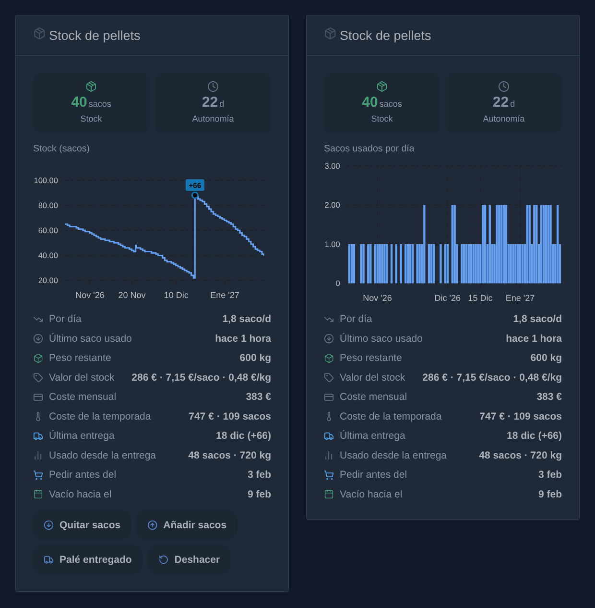
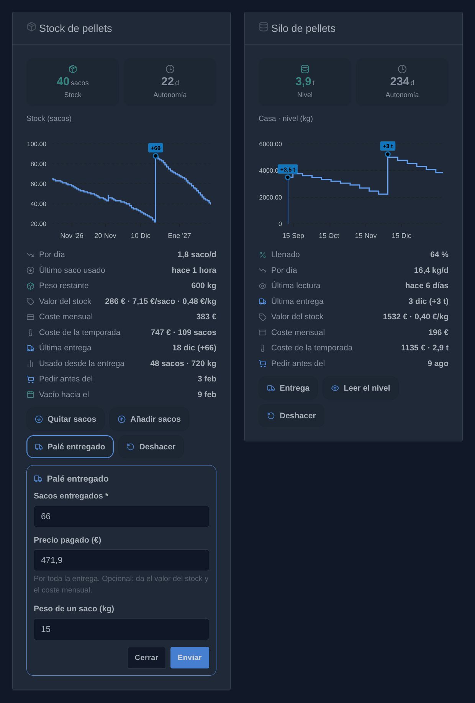
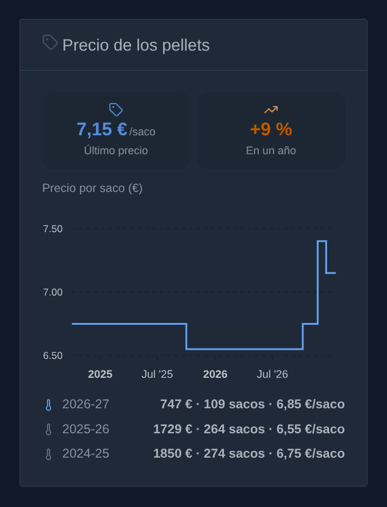
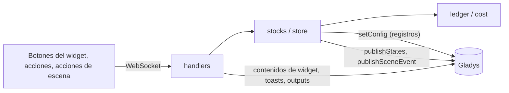
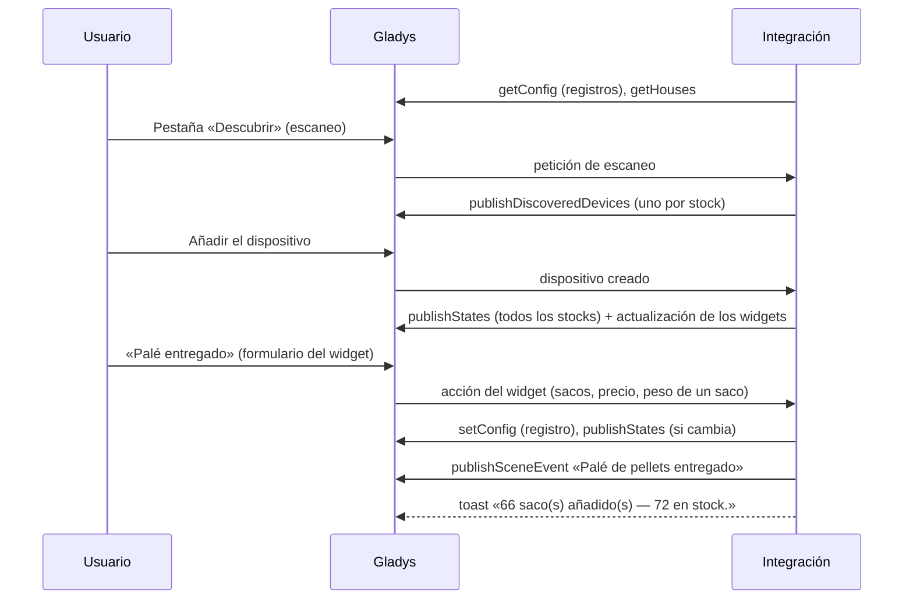
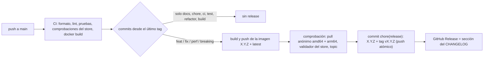

# Gladys Pellet Stock

[English](README.md) · [Français](README.fr.md) · [Deutsch](README.de.md) · **Español**

[](LICENSE)
[](https://github.com/William-De71/gladys-pellet-stock/releases)
[](https://github.com/William-De71/gladys-pellet-stock/actions/workflows/release.yml)
[](https://gladysassistant.com)

Integración externa para [Gladys Assistant](https://gladysassistant.com) que sigue un **stock de pellets**, en
sacos o en un silo a granel, uno por casa: entregas, consumo, consumo medio diario, autonomía y coste de la
calefacción, con **widgets** para el panel, acciones y disparadores de escena, construida sobre
`@gladysassistant/integration-sdk` 0.15.

Sin hardware ni cuenta en línea: la integración lleva un registro de movimientos y deduce todo lo demás.







_Ilustraciones generadas, no capturas de pantalla: los contenidos salen del código de la integración, dibujados como los widgets de Gladys (modo oscuro). La evolución del stock con sus botones, y los sacos usados por día con los botones ocultos; debajo, el formulario «Palé entregado» y un silo._

Documentación de usuario: [English](docs/en.md) · [Français](docs/fr.md) · [Deutsch](docs/de.md) ·
[Español](docs/es.md).

## Índice

- [Funciones](#funciones)
- [Arquitectura](#arquitectura)
- [Instalación](#instalación)
- [Configuración](#configuración)
- [Cómo se calculan las cifras](#cómo-se-calculan-las-cifras)
- [Desarrollo](#desarrollo)
- [Release y convención de commits](#release-y-convención-de-commits)
- [Solución de problemas](#solución-de-problemas)
- [Contribuir](#contribuir)
- [Licencia](#licencia)

## Funciones

### Widgets del panel

**«Stock de pellets»** (sacos):

- **Mosaicos**: el stock en sacos (verde, naranja por debajo del umbral de stock bajo, rojo a cero) y la autonomía
  en días.
- **Gráfico**, elegido por widget: la **evolución del stock** (línea escalonada, entregas señaladas) o los **sacos
  usados por día** (barras; por semana sobre un año). Periodo: 1 mes, 3 meses o 1 año.
- **Filas de estado**: sacos por día, último saco usado («hace 2 horas»), peso restante, valor del stock con el
  precio por saco y por kg, coste mensual y coste de la temporada (en cuanto se conoce un precio), última entrega y
  sacos usados desde entonces, la fecha antes de la que pedir y la fecha estimada en que se vaciará.
- **Botones**: **Quitar sacos** (un formulario para los sacos), **Añadir sacos** (los sacos y el precio por saco),
  **Palé entregado** (los sacos, el precio pagado y el peso de un saco) y **Deshacer**. Se pueden ocultar por
  widget, para una pantalla de pared de solo lectura.

**«Precio de los pellets»** (sacos o silo, solo lectura): el último precio pagado y su evolución en un año, una
línea escalonada del precio por saco (por tonelada para un silo) en 1, 3 o 5 años, y una fila por temporada de
calefacción, la actual en azul: lo que costaron los pellets usados (primero en entrar, primero en salir), cuántos y el
precio medio de uno.

**«Silo de pellets»** (granel): nivel, autonomía, gráfico del nivel o de los kg por día, llenado, última lectura,
valor y precio por kg, coste de la temporada, fecha de pedido; **Entrega**, **Leer el nivel** (en kg o en % de la
capacidad) y **Deshacer**.

### Dispositivos

Un dispositivo virtual por stock, propuesto en la pestaña «Descubrir» (opcional), todas las funciones de solo
lectura con historial:

| Dispositivo               | Función              | Categoría / tipo                        | Unidad / límites |
| ------------------------- | -------------------- | --------------------------------------- | ---------------- |
| Stock de pellets (– Casa) | Stock de pellets     | `counter-sensor` / `integer`            | 0–10 000 sacos   |
|                           | Autonomía de pellets | `duration` / `integer`                  | días, 0–3650     |
| Silo de pellets – Casa    | Nivel del silo (kg)  | `counter-sensor` / `integer`            | 0–100 000 kg     |
|                           | Llenado del silo     | `level-sensor` / `liquid-level-percent` | %, 0–100         |
|                           | Autonomía del silo   | `duration` / `integer`                  | días, 0–3650     |

Identificadores externos: `ext:<selector>:pellet:stock` para el stock principal,
`ext:<selector>:pellet:<casa>:<bags|bulk>` para un stock añadido para una casa. Una autonomía desconocida nunca se
publica como 0 (un 0 dispararía las escenas de «vacío»).

### Varias casas

**«Añadir un stock»** crea un stock para una casa de Gladys (como mucho un stock de sacos y un silo por casa, con su
nombre), con su propio historial y su propio dispositivo. **«Configurar un stock»** da a un stock ajustes propios, en
lugar de los valores por defecto de la configuración; **«Asignar un stock a una casa»** asigna el stock principal, o
un stock añadido con un nombre antes de las casas, conservando su dispositivo y su historial. Los nombres de las casas
se leen en Gladys (`location: true`; las coordenadas no se usan). Los widgets, las acciones, las acciones de escena y
los disparadores tienen todos un campo **Stock**; vacío, usan el stock principal (disparadores: todos los stocks;
acciones del silo: el único silo).

### Escenas

| Acción de escena                   | Qué hace                                                                      |
| ---------------------------------- | ----------------------------------------------------------------------------- |
| **Usar sacos de pellets**          | Quita sacos: por ejemplo un botón Zigbee junto a la estufa, uno por pulsación |
| **Añadir sacos de pellets**        | Añade sacos comprados sueltos, o una entrega si «Entrega» está marcado        |
| **Corregir el stock de pellets**   | Fija el stock en los sacos contados                                           |
| **Leer el stock de pellets**       | No cambia nada: las cifras, el tipo, la unidad y el coste de la temporada     |
| **Registrar una entrega del silo** | Añade a un silo los kg entregados                                             |
| **Leer el nivel del silo**         | Fija el nivel de un silo, en kg o en %: un sensor de nivel puede alimentarlo  |

Cada acción devuelve el **stock**, la **autonomía**, el **consumo diario**, los **días antes de pedir** y (sacos) el
**peso restante**; una cifra todavía desconocida se omite, nunca se envía como 0.

| Disparador de escena          | Se dispara cuando                                                  |
| ----------------------------- | ------------------------------------------------------------------ |
| **Stock de pellets bajo**     | El stock cruza el umbral de stock bajo (una vez, no con cada saco) |
| **Stock de pellets agotado**  | Se usa el último saco                                              |
| **Palé de pellets entregado** | Se registra una entrega de varios sacos                            |

Los disparadores transmiten las mismas cifras como variables de escena. Ejemplo: **Stock de pellets bajo** →
enviar el mensaje «Quedan `{{triggerEvent.data.bags_left}}` sacos, hora de pedir». Según la regla «sin bucles» del
SDK, una entrega añadida por una escena nunca dispara «Palé de pellets entregado». Los disparadores en sacos dejan
fuera los silos: use el dispositivo del silo.

### Acciones de la configuración

Corregir el stock, registrar una entrega o un consumo de cualquier tamaño, deshacer la última operación, **analizar
el coste** de un periodo (primero en entrar, primero en salir), añadir, asignar, configurar o eliminar un stock.

### Idiomas

Español, inglés, francés y alemán: manifiesto, mensajes en ejecución, widgets y documentación. Gladys solo transmite
el idioma de sus usuarios a los widgets: por defecto (**Idioma de los nombres de dispositivos** = `auto`), los nombres
de los dispositivos propuestos en la pestaña «Descubrir» siguen el idioma del último usuario que mostró un widget,
guardado en Gladys (`last_language`). El ajuste también puede imponer inglés, francés, alemán o español.

## Arquitectura




De la pestaña «Descubrir» a un estado, y luego un botón del widget:



Cada hora, la autonomía (que varía con el tiempo) se vuelve a publicar si ha cambiado, y se vuelven a leer los
nombres de las casas. La integración es solo local (`transports: ["local"]`): solo habla con Gladys.

## Instalación

Desde Gladys: **Integraciones → store → Pellet Stock → Instalar**. Siga después la
[documentación de usuario](docs/es.md): compruebe el peso de un saco y los sacos por palé, ejecute **«Corregir el
stock»**, añada el widget **«Stock de pellets»** a un panel y, si lo desea, el dispositivo desde la pestaña
**Descubrir**.

Imagen Docker: `ghcr.io/william-de71/gladys-pellet-stock`, multiarquitectura (amd64/arm64), sin root, sistema de
archivos de solo lectura, etiquetas OCI y el manifiesto en la etiqueta `io.gladysassistant.manifest`.

## Configuración

| Clave                   | Tipo     | Por defecto | Sirve para                                                                                 |
| ----------------------- | -------- | ----------- | ------------------------------------------------------------------------------------------ |
| `language`              | `select` | `auto`      | Los nombres de los dispositivos propuestos en «Descubrir» (`auto`, `en`, `fr`, `de`, `es`) |
| `bag_weight`            | `number` | 15          | El peso restante y el peso usado (kg)                                                      |
| `pallet_size`           | `number` | 66          | Lo que añade el botón «Palé entregado»                                                     |
| `low_stock_threshold`   | `number` | 10          | El stock en naranja, el recordatorio, la fecha de pedido, el disparador (sacos)            |
| `consumption_window`    | `number` | 14          | Los días sobre los que se calcula el consumo medio                                         |
| `pallet_price`          | `number` | —           | Opcional: valor del stock y coste mensual, mientras ninguna entrega tenga precio           |
| `bulk_capacity`         | `number` | —           | Silo: el porcentaje de llenado, y el nivel leído en %                                      |
| `bulk_low_threshold`    | `number` | 500         | Silo: el nivel en naranja y el recordatorio (kg)                                           |
| `bulk_delivery_default` | `number` | 3000        | Silo: rellena de antemano el formulario «Entrega» (kg)                                     |
| `bulk_tonne_price`      | `number` | —           | Silo: precio por tonelada opcional, mientras ninguna entrega tenga precio                  |
| `bulk_reading_unit`     | `select` | `kg`        | Silo: el formulario «Leer el nivel» pide en `kg` o en `percent`                            |

Son los valores por defecto de todos los stocks: «Configurar un stock» los sustituye para un stock.

El registro de cada stock (los 2000 últimos movimientos; más allá, los más antiguos se agrupan en un movimiento
`opening` que conserva los lotes aún en stock) se guarda con `setConfig()`, en claves fuera del `config_schema`
(`stock_ledger` para el stock principal, una clave aleatoria `stock_ledger_<id>` para los demás, `stocks` para su
lista, sus casas y sus ajustes). Vive en la base de datos de Gladys: forma parte de las copias de seguridad de Gladys
y sobrevive a una reconstrucción del contenedor.

## Cómo se calculan las cifras

- Una **corrección a la baja** del stock cuenta como consumo: recontar el stock cada dos semanas basta para obtener
  un consumo. En el gráfico de consumo, esos sacos caen el día del recuento.
- El **consumo diario** es la media de los últimos _N_ días (14 por defecto), o del historial conocido si es más
  corto. Con menos de un día de historial sigue siendo desconocido, en lugar de extrapolar una sola pulsación.
- La **autonomía** es el stock dividido por ese consumo, y la **fecha de pedido** es aquella en que el stock
  alcanzará el umbral a ese ritmo. Sin ningún consumo en el periodo (verano), ambas son desconocidas: se muestran
  con un guion y nunca se publican como 0.
- El **coste** sigue el principio primero en entrar, primero en salir: cada entrega es un lote al precio pagado (o
  al último precio por saco conocido), cada saco usado se toma del lote más antiguo. La fila **coste de la
  temporada** (inicio de temporada ajustado por widget) y la acción **«Analizar el coste»** suman los sacos usados en
  un periodo al precio de su lote; el peso restante sigue el peso de los sacos de cada lote. Los sacos sin precio se
  indican aparte.
- Solo las **entregas** cuentan como entregas (marcas del gráfico, «última entrega», «usado desde la entrega», el
  disparador): «Palé entregado», «Registrar una entrega», una entrega del silo. Los sacos añadidos con «Añadir
  sacos», sean cuantos sean, son una compra.

## Desarrollo

```bash
npm ci
npm run format:check
npm run lint
npm test
npx github:GladysAssistant/integration-store . --skip-image-check
docker build -t gladys-pellet-stock .
```

Node 22 o posterior. Las pruebas (`node --test`) nunca acceden a la red. Con `DEBUG=gladys-integration-sdk`, el SDK
valida cada contenido de widget contra el vocabulario y el presupuesto del núcleo, y registra lo que el núcleo
descartaría.

- `test/structure.test.js` compara los identificadores externos de los dispositivos, los campos de las funciones que
  compara la pestaña «Descubrir» y todas las claves del manifiesto con `test/fixtures/discovery.baseline.json`: los
  usuarios existentes nunca tienen que volver a crear un dispositivo;
- `test/i18n.test.js` comprueba los cuatro idiomas (manifiesto, textos en ejecución, documentación, README) y valida
  los contenidos de widget en cada uno;
- `test/release.test.js` cubre el script de release (versión, changelog, actualización de versiones).

`docs/illustrations/render.sh` regenera las ilustraciones de los widgets de `docs/assets/` en los cuatro idiomas, a
partir del código de la integración, dibujadas como el front de Gladys (se necesitan Chrome o Chromium, ImageMagick y
Pillow).

| Ruta                  | Función                                                                 |
| --------------------- | ----------------------------------------------------------------------- |
| `index.js`            | Punto de entrada: ciclo de vida, actualización cada hora                |
| `src/handlers.js`     | Handlers de las acciones, acciones de escena, widgets y descubrimiento  |
| `src/stocks.js`       | Los stocks: el principal y los añadidos (casas, ajustes)                |
| `src/store.js`        | Un stock: persistencia, estados del dispositivo, disparadores de escena |
| `src/ledger.js`       | El registro y todas las cifras que se derivan de él (funciones puras)   |
| `src/cost.js`         | Coste primero en entrar, primero en salir                               |
| `src/widget.js`       | El contenido del widget «Stock de pellets»                              |
| `src/silo-widget.js`  | El contenido del widget «Silo de pellets»                               |
| `src/price-widget.js` | El contenido del widget «Precio de los pellets»                         |
| `src/scene.js`        | Outputs de las acciones de escena y detección de los disparadores       |
| `src/i18n.js`         | Textos en ejecución, en / fr / de / es                                  |

`gladys_version` es `>=5.2.0` (formularios de los botones de widget, listas de casas). Gladys 5.1 conserva la
versión 1.2.0 de la integración y no recibe las versiones siguientes.

## Release y convención de commits

Las releases son automáticas. Cada push a `main` lanza el workflow Release:



- Los commits y los títulos de PR siguen los [Conventional Commits](https://www.conventionalcommits.org/), en
  inglés, escritos para el usuario: se convierten en las líneas del changelog. `feat` → minor, `fix` / `perf` →
  patch, `!` o `BREAKING CHANGE:` → major.
- `CHANGELOG.md` se genera en la release: no editarlo nunca a mano.
- La imagen se publica y se comprueba **antes** de que el manifiesto de `main` anuncie la nueva versión.
- Ejecución manual (Actions → Release → Run workflow): `release-as` fuerza una versión, `dry-run` solo muestra la
  versión y las notas.
- Una rama `main` protegida rechazaría el commit de release: permita a GitHub Actions saltarse la regla, o use el
  token de una GitHub App.

## Solución de problemas

| Síntoma                                       | Causa probable                                                                      |
| --------------------------------------------- | ----------------------------------------------------------------------------------- |
| Autonomía mostrada con un guion               | menos de un día de historial, o ningún consumo en el periodo (verano)               |
| «Solo hay N saco(s) en stock»                 | el stock registrado es menor que los sacos quitados: ejecute «Corregir el stock»    |
| El widget pide elegir un stock                | el stock se ha eliminado, o es un silo en un widget de sacos (o al revés)           |
| Falta un stock añadido en la lista del widget | su dispositivo todavía no se ha añadido desde la pestaña «Descubrir»                |
| Nombres de dispositivos en inglés             | aún no se ha mostrado ningún widget: abra uno, o imponga el idioma en el ajuste     |
| Los botones añaden un saco sin formulario     | la versión de Gladys no tiene formularios de widget (se necesita 5.2.0 o posterior) |
| No se propone la actualización                | Gladys anterior a 5.2.0, o el store aún no ha indexado la versión (en el día)       |

Registros detallados: defina la variable de entorno `DEBUG=gladys-integration-sdk` en el contenedor.

## Contribuir

Las issues y las pull requests son bienvenidas: informes de errores con la versión de Gladys, la versión de la
integración y los registros ([plantillas de issue](.github/ISSUE_TEMPLATE)). Comentarios también en el
[hilo del foro de Gladys](https://community.gladysassistant.com/t/integration-externe-stock-pellets/10907) (en
francés). Problemas de seguridad: vea [SECURITY.md](SECURITY.md).

## Licencia

[Apache-2.0](LICENSE) — vea [NOTICE](NOTICE).
