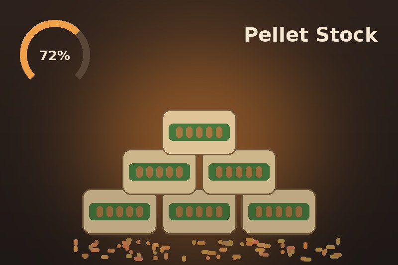
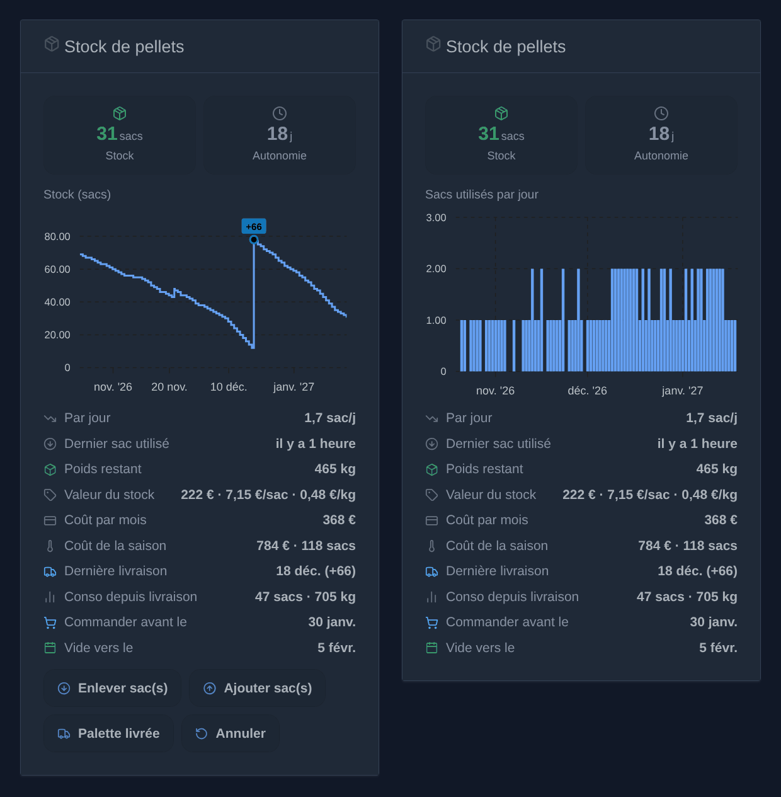
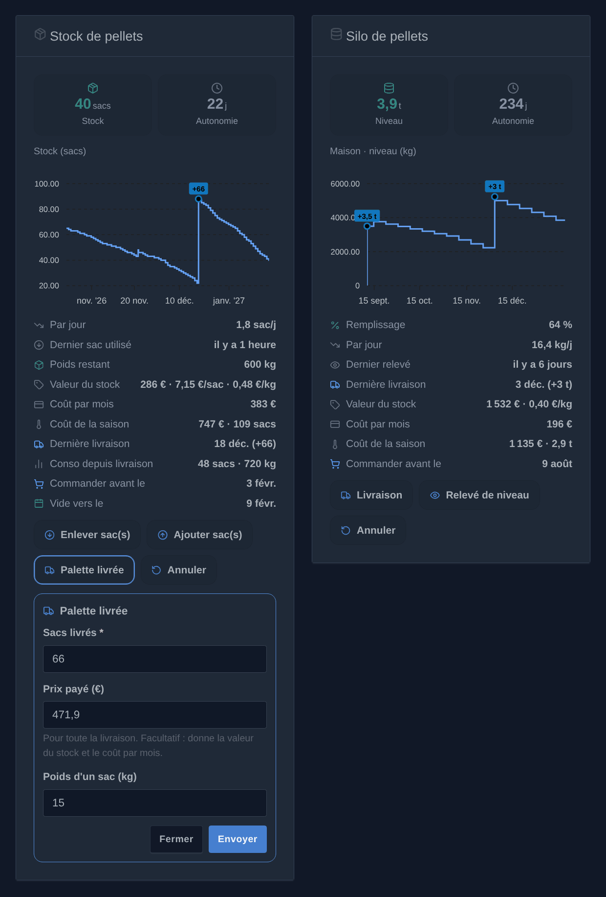
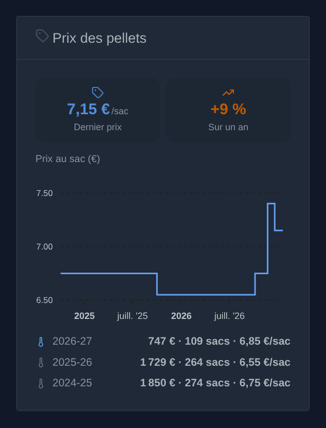
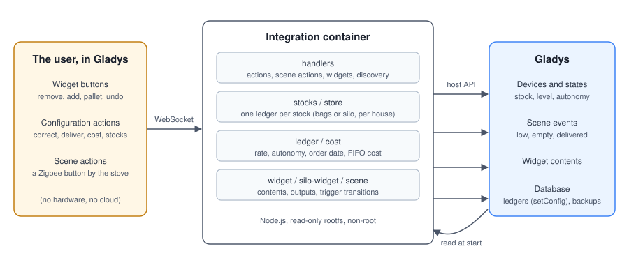
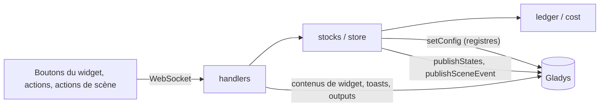
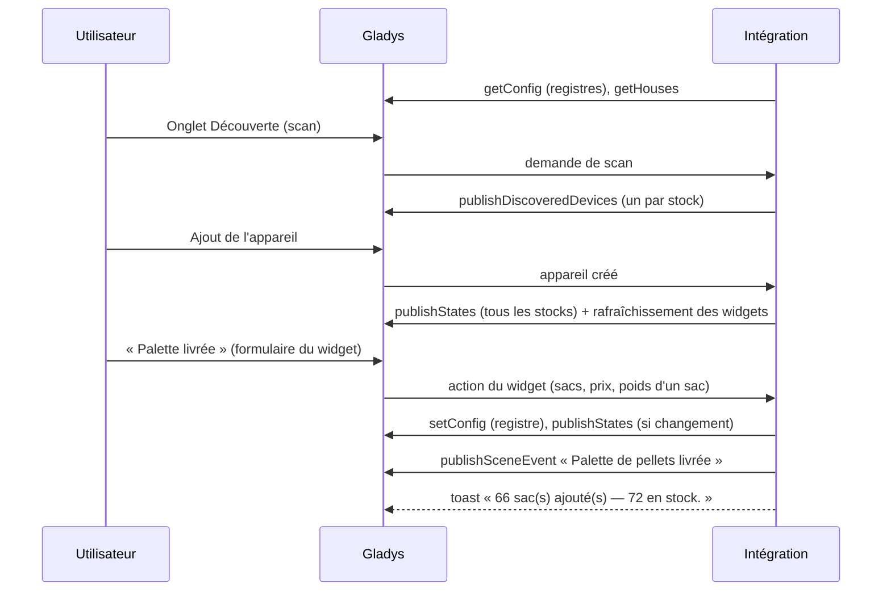
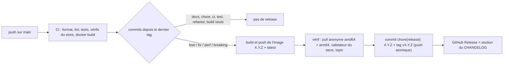

# Gladys Pellet Stock

[English](README.md) · **Français** · [Deutsch](README.de.md) · [Español](README.es.md)

[](LICENSE)
[](https://github.com/William-De71/gladys-pellet-stock/releases)
[](https://github.com/William-De71/gladys-pellet-stock/actions/workflows/release.yml)
[](https://gladysassistant.com)



Intégration externe pour [Gladys Assistant](https://gladysassistant.com) qui suit un **stock de pellets** (granulés
de bois), en sacs ou en silo vrac, un par maison : livraisons, consommation, consommation moyenne par jour, autonomie
et coût du chauffage, avec des **widgets** de tableau de bord, des actions et des déclencheurs de scène, construite sur
`@gladysassistant/integration-sdk` 0.15.

Ni matériel ni compte en ligne : l'intégration tient un registre des mouvements et en déduit tout le reste.







_Illustrations générées, pas des captures d'écran : les contenus viennent du code de l'intégration, dessinés comme les widgets de Gladys (mode sombre). L'évolution du stock avec ses boutons, et les sacs utilisés par jour, boutons masqués ; en dessous, le formulaire « Palette livrée » et un silo._

Documentation utilisateur : [English](docs/en.md) · [Français](docs/fr.md) · [Deutsch](docs/de.md) ·
[Español](docs/es.md).

## Sommaire

- [Fonctionnalités](#fonctionnalités)
- [Architecture](#architecture)
- [Installation](#installation)
- [Configuration](#configuration)
- [Comment les chiffres sont calculés](#comment-les-chiffres-sont-calculés)
- [Développement](#développement)
- [Release et convention de commits](#release-et-convention-de-commits)
- [Dépannage](#dépannage)
- [Contribuer](#contribuer)
- [Licence](#licence)

## Fonctionnalités

### Widgets du tableau de bord

**« Stock de pellets »** (sacs) :

- **Tuiles** : le stock en sacs (vert, orange sous le seuil de stock bas, rouge à zéro) et l'autonomie en jours.
- **Graphique**, choisi par widget : l'**évolution du stock** (courbe en escalier, livraisons repérées) ou les **sacs
  utilisés par jour** (barres ; par semaine sur un an). Période : 1 mois, 3 mois ou 1 an.
- **Lignes d'état** : sacs par jour, dernier sac utilisé (« il y a 2 heures »), poids restant, valeur du stock avec le
  prix au sac et au kg, coût par mois et coût de la saison (dès qu'un prix est connu), dernière livraison et sacs
  utilisés depuis, date avant laquelle commander et date estimée où le stock sera vide.
- **Boutons** : **Enlever sac(s)** (un formulaire pour les sacs), **Ajouter sac(s)** (les sacs et le prix au sac),
  **Palette livrée** (les sacs, le prix payé et le poids d'un sac) et **Annuler**. Ils peuvent être masqués par
  widget, pour un écran mural en lecture seule.

**« Prix des pellets »** (sacs ou silo, en lecture seule) : le dernier prix payé et son évolution sur un an, la
courbe en escalier du prix au sac (à la tonne pour un silo) sur 1, 3 ou 5 ans, et une ligne par saison de chauffe, la
saison en cours en bleu : ce qu'ont coûté les pellets utilisés (premier entré, premier sorti), leur nombre et le prix
moyen de l'un d'eux.

**« Silo de pellets »** (vrac) : niveau, autonomie, graphique du niveau ou des kg par jour, remplissage, dernier
relevé, valeur et prix au kg, coût de la saison, date de commande ; **Livraison**, **Relevé de niveau** (en kg ou en %
de la capacité) et **Annuler**.

### Appareils

Un appareil virtuel par stock, proposé dans l'onglet Découverte (facultatif), toutes les fonctionnalités en lecture
seule avec historique :

| Appareil                    | Fonctionnalité      | Catégorie / type                        | Unité / bornes |
| --------------------------- | ------------------- | --------------------------------------- | -------------- |
| Stock de pellets (– Maison) | Stock de pellets    | `counter-sensor` / `integer`            | 0–10 000 sacs  |
|                             | Autonomie pellets   | `duration` / `integer`                  | jours, 0–3 650 |
| Silo de pellets – Maison    | Niveau du silo (kg) | `counter-sensor` / `integer`            | 0–100 000 kg   |
|                             | Remplissage du silo | `level-sensor` / `liquid-level-percent` | %, 0–100       |
|                             | Autonomie du silo   | `duration` / `integer`                  | jours, 0–3 650 |

Identifiants externes : `ext:<selector>:pellet:stock` pour le stock principal,
`ext:<selector>:pellet:<maison>:<bags|bulk>` pour un stock ajouté pour une maison. Une autonomie inconnue n'est jamais
publiée à 0 (un 0 déclencherait les scènes « vide »).

### Plusieurs maisons

**« Ajouter un stock »** crée un stock pour une maison de Gladys (au plus un stock de sacs et un silo par maison,
nommés d'après elle), avec son propre historique et son propre appareil. **« Régler un stock »** donne à un stock des
réglages propres, à la place des valeurs par défaut de la configuration ; **« Rattacher un stock à une maison »**
rattache le stock principal, ou un stock ajouté avec un nom avant les maisons, en gardant son appareil et son
historique. Les noms des maisons sont lus dans Gladys (`location: true` ; les coordonnées ne sont pas utilisées). Les
widgets, les actions, les actions de scène et les déclencheurs ont tous un champ **Stock** ; laissé vide, ils
utilisent le stock principal (déclencheurs : tous les stocks ; actions du silo : le seul silo).

### Scènes

| Action de scène                       | Ce qu'elle fait                                                                 |
| ------------------------------------- | ------------------------------------------------------------------------------- |
| **Utiliser des sacs de pellets**      | Retire des sacs : par exemple un bouton Zigbee près du poêle, un par appui      |
| **Ajouter des sacs de pellets**       | Ajoute des sacs achetés à l'unité, ou une livraison si « Livraison » est coché  |
| **Corriger le stock de pellets**      | Fixe le stock au nombre de sacs comptés                                         |
| **Lire le stock de pellets**          | Ne modifie rien : les chiffres, le type, l'unité et le coût de la saison        |
| **Enregistrer une livraison du silo** | Ajoute les kg livrés à un silo                                                  |
| **Relever le niveau du silo**         | Fixe le niveau d'un silo, en kg ou en % : un capteur de niveau peut l'alimenter |

Chaque action renvoie le **stock**, l'**autonomie**, la **consommation par jour**, les **jours avant de commander**
et (sacs) le **poids restant** ; un chiffre encore inconnu est omis, jamais envoyé à 0.

| Déclencheur de scène          | Se déclenche quand                                                   |
| ----------------------------- | -------------------------------------------------------------------- |
| **Stock de pellets bas**      | Le stock franchit le seuil de stock bas (une fois, pas à chaque sac) |
| **Stock de pellets épuisé**   | Le dernier sac est utilisé                                           |
| **Palette de pellets livrée** | Une livraison de plusieurs sacs est enregistrée                      |

Les déclencheurs transmettent les mêmes chiffres en variables de scène. Exemple : **Stock de pellets bas** → envoyer
le message « `{{triggerEvent.data.bags_left}}` sacs restants, pensez à commander ». Conformément à la règle « pas de
boucle » du SDK, une livraison ajoutée par une scène ne déclenche jamais « Palette de pellets livrée ». Les
déclencheurs en sacs laissent les silos de côté : utilisez l'appareil du silo.

### Actions de la configuration

Corriger le stock, enregistrer une livraison ou une consommation de n'importe quelle taille, annuler la dernière
opération, **analyser le coût** d'une période (premier entré, premier sorti), ajouter, rattacher, régler ou supprimer
un stock.

### Langues

Français, anglais, allemand et espagnol : manifeste, messages à l'exécution, widgets et documentation. Gladys ne
transmet la langue de ses utilisateurs qu'aux widgets : par défaut (**Langue des noms d'appareils** = `auto`), les
noms des appareils proposés dans l'onglet Découverte suivent la langue du dernier utilisateur qui a affiché un widget,
mémorisée dans Gladys (`last_language`). Le réglage peut aussi imposer l'anglais, le français, l'allemand ou
l'espagnol.

## Architecture





De l'onglet Découverte à un état, puis un bouton du widget :



Toutes les heures, l'autonomie (qui dérive avec le temps) est republiée si elle a changé, et les noms des maisons
sont relus. L'intégration est uniquement locale (`transports: ["local"]`) : elle ne parle qu'à Gladys.

## Installation

Depuis Gladys : **Intégrations → store → Pellet Stock → Installer**. Suivez ensuite la
[documentation utilisateur](docs/fr.md) : vérifiez le poids d'un sac et le nombre de sacs par palette, lancez
**« Corriger le stock »**, ajoutez le widget **« Stock de pellets »** à un tableau de bord et, si vous le souhaitez,
l'appareil depuis l'onglet **Découverte**.

Image Docker : `ghcr.io/william-de71/gladys-pellet-stock`, multi-architecture (amd64/arm64), utilisateur non root,
système de fichiers en lecture seule, labels OCI et manifeste dans le label `io.gladysassistant.manifest`.

## Configuration

| Clé                     | Type     | Défaut | Sert à                                                                                    |
| ----------------------- | -------- | ------ | ----------------------------------------------------------------------------------------- |
| `language`              | `select` | `auto` | Les noms des appareils proposés dans l'onglet Découverte (`auto`, `en`, `fr`, `de`, `es`) |
| `bag_weight`            | `number` | 15     | Le poids restant et le poids utilisé (kg)                                                 |
| `pallet_size`           | `number` | 66     | Ce qu'ajoute le bouton « Palette livrée »                                                 |
| `low_stock_threshold`   | `number` | 10     | Le stock en orange, le rappel, la date de commande, le déclencheur (sacs)                 |
| `consumption_window`    | `number` | 14     | Les jours sur lesquels la consommation moyenne est calculée                               |
| `pallet_price`          | `number` | —      | Facultatif : valeur du stock et coût par mois, tant qu'aucune livraison n'a de prix       |
| `bulk_capacity`         | `number` | —      | Silo : le taux de remplissage, et le niveau relevé en %                                   |
| `bulk_low_threshold`    | `number` | 500    | Silo : le niveau en orange et le rappel (kg)                                              |
| `bulk_delivery_default` | `number` | 3000   | Silo : pré-remplit le formulaire « Livraison » (kg)                                       |
| `bulk_tonne_price`      | `number` | —      | Silo : prix à la tonne facultatif, tant qu'aucune livraison n'a de prix                   |
| `bulk_reading_unit`     | `select` | `kg`   | Silo : le formulaire « Relevé de niveau » demande en `kg` ou en `percent`                 |

Ce sont les valeurs par défaut de tous les stocks : « Régler un stock » les remplace pour un stock.

Le registre de chaque stock (les 2 000 derniers mouvements ; au-delà, les plus anciens sont regroupés dans un
mouvement `opening` qui garde les lots encore en stock) est enregistré avec `setConfig()`, sous des clés hors du
`config_schema` (`stock_ledger` pour le stock principal, une clé aléatoire `stock_ledger_<id>` pour les autres,
`stocks` pour leur liste, leurs maisons et leurs réglages). Il vit dans la base de Gladys : il fait partie des
sauvegardes Gladys et survit à une reconstruction du conteneur.

## Comment les chiffres sont calculés

- Une **correction à la baisse** du stock compte comme consommation : recompter le stock toutes les deux semaines
  suffit pour obtenir une consommation. Sur le graphique de consommation, ces sacs tombent le jour du recomptage.
- La **consommation par jour** est la moyenne des _N_ derniers jours (14 par défaut), ou de l'historique connu s'il
  est plus court. Sous un jour d'historique, elle reste inconnue plutôt que d'extrapoler un seul appui.
- L'**autonomie** est le stock divisé par cette consommation, et la **date de commande** est celle où le stock
  atteindra le seuil à ce rythme. Sans aucune consommation sur la période (l'été), les deux sont inconnues :
  affichées par un tiret, jamais publiées à 0.
- Le **coût** suit le principe premier entré, premier sorti : chaque livraison est un lot au prix payé (ou au dernier
  prix au sac connu), chaque sac utilisé est pris dans le lot le plus ancien. La ligne **coût de la saison** (début de
  saison réglé par widget) et l'action **« Analyser le coût »** additionnent les sacs utilisés sur une période au prix
  de leur lot ; le poids restant suit le poids des sacs de chaque lot. Les sacs sans prix sont indiqués à part.
- Seules les **livraisons** comptent comme livraisons (repères du graphique, « dernière livraison », « conso depuis
  livraison », le déclencheur) : « Palette livrée », « Enregistrer une livraison », une livraison du silo. Les sacs
  ajoutés avec « Ajouter sac(s) », quel que soit leur nombre, sont un achat.

## Développement

```bash
npm ci
npm run format:check
npm run lint
npm test
npx github:GladysAssistant/integration-store . --skip-image-check
docker build -t gladys-pellet-stock .
```

Node 22 ou plus récent. Les tests (`node --test`) n'accèdent jamais au réseau. `DEBUG=gladys-integration-sdk` fait
valider par le SDK chaque contenu de widget par rapport au vocabulaire et au budget du cœur, et journalise ce que le
cœur supprimerait.

- `test/structure.test.js` compare les identifiants externes des appareils, les champs des fonctionnalités que
  l'onglet Découverte compare et toutes les clés du manifeste à `test/fixtures/discovery.baseline.json` : les
  utilisateurs existants n'ont jamais à recréer un appareil ;
- `test/i18n.test.js` vérifie les quatre langues (manifeste, messages, docs, README) et valide les contenus de widget
  dans chacune ;
- `test/release.test.js` couvre le script de release (version, changelog, mise à jour des versions).

`docs/illustrations/render.sh` régénère les illustrations des widgets de `docs/assets/` dans les quatre langues, à
partir du code de l'intégration, dessinées comme le front de Gladys (Chrome ou Chromium, ImageMagick et Pillow
requis).

| Chemin                | Rôle                                                                |
| --------------------- | ------------------------------------------------------------------- |
| `index.js`            | Point d'entrée : cycle de vie, rafraîchissement horaire             |
| `src/handlers.js`     | Handlers des actions, actions de scène, widgets et de la découverte |
| `src/stocks.js`       | Les stocks : le principal et les stocks ajoutés (maisons, réglages) |
| `src/store.js`        | Un stock : persistance, états de l'appareil, déclencheurs de scène  |
| `src/ledger.js`       | Le registre et tous les chiffres qui en découlent (fonctions pures) |
| `src/cost.js`         | Coût premier entré, premier sorti                                   |
| `src/widget.js`       | Le contenu du widget « Stock de pellets »                           |
| `src/silo-widget.js`  | Le contenu du widget « Silo de pellets »                            |
| `src/price-widget.js` | Le contenu du widget « Prix des pellets »                           |
| `src/scene.js`        | Outputs des actions de scène et détection des déclencheurs          |
| `src/i18n.js`         | Textes à l'exécution, en / fr / de / es                             |

`gladys_version` est `>=5.2.0` (formulaires des boutons de widget, listes de maisons). Gladys 5.1 garde la
version 1.2.0 de l'intégration et ne reçoit pas les versions suivantes.

## Release et convention de commits

Les releases sont automatiques. Chaque push sur `main` lance le workflow Release :



- Les commits et les titres de PR suivent les [Conventional Commits](https://www.conventionalcommits.org/), en
  anglais, rédigés pour l'utilisateur : ils deviennent les lignes du changelog. `feat` → mineure, `fix` / `perf` →
  correctif, `!` ou `BREAKING CHANGE:` → majeure.
- `CHANGELOG.md` est généré à la release : ne jamais l'éditer à la main.
- L'image est publiée et vérifiée **avant** que le manifeste sur `main` n'annonce la nouvelle version.
- Lancement manuel (Actions → Release → Run workflow) : `release-as` force une version, `dry-run` affiche seulement
  la version et les notes.
- Une branche `main` protégée refuserait le commit de release : autorisez GitHub Actions à contourner la règle, ou
  utilisez le jeton d'une GitHub App.

## Dépannage

| Symptôme                                       | Cause probable                                                                           |
| ---------------------------------------------- | ---------------------------------------------------------------------------------------- |
| Autonomie affichée par un tiret                | moins d'un jour d'historique, ou aucune consommation sur la période (l'été)              |
| « Seulement N sac(s) en stock »                | le stock enregistré est inférieur aux sacs retirés : lancez « Corriger le stock »        |
| Le widget demande de choisir un stock          | le stock a été supprimé, ou c'est un silo dans un widget de sacs (ou l'inverse)          |
| Un stock ajouté manque dans la liste du widget | son appareil n'a pas encore été ajouté depuis l'onglet Découverte                        |
| Noms d'appareils en anglais                    | aucun widget encore affiché : ouvrez-en un, ou imposez **Langue des noms d'appareils**   |
| Les boutons ajoutent un sac sans formulaire    | la version de Gladys n'a pas les formulaires de widget (5.2.0 ou plus requis)            |
| La mise à jour n'est pas proposée              | Gladys antérieur à 5.2.0, ou le store n'a pas encore indexé la version (dans la journée) |

Journaux détaillés : définissez la variable d'environnement `DEBUG=gladys-integration-sdk` sur le conteneur.

## Contribuer

Les issues et les pull requests sont les bienvenues : rapports de bug avec la version de Gladys, la version de
l'intégration et les journaux ([modèles d'issue](.github/ISSUE_TEMPLATE)). Les retours sont aussi les bienvenus sur
le [fil du forum Gladys](https://community.gladysassistant.com/t/integration-externe-stock-pellets/10907). Problèmes
de sécurité : voir [SECURITY.md](SECURITY.md).

## Licence

[Apache-2.0](LICENSE) — voir [NOTICE](NOTICE).
