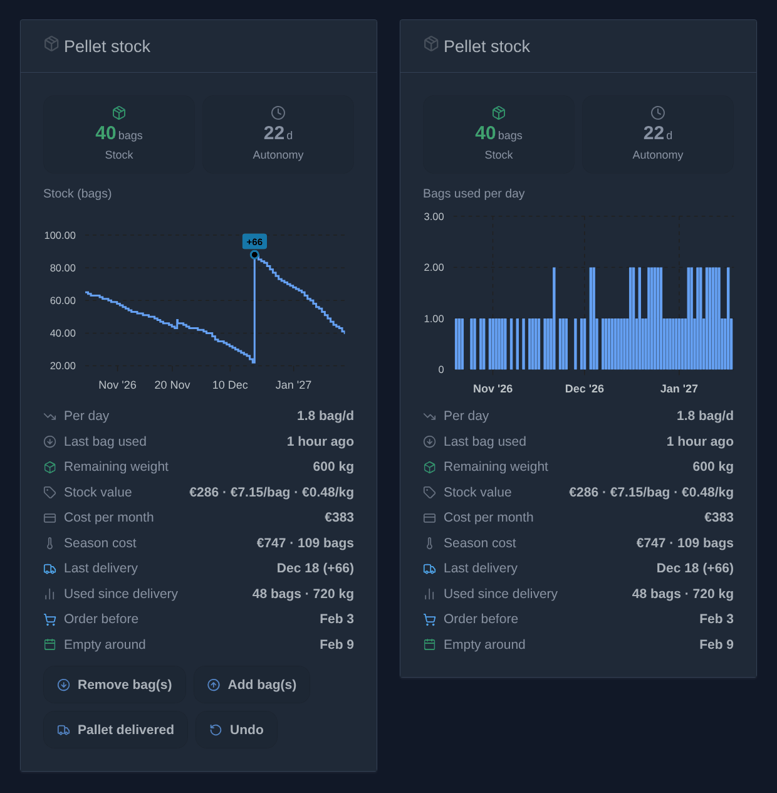
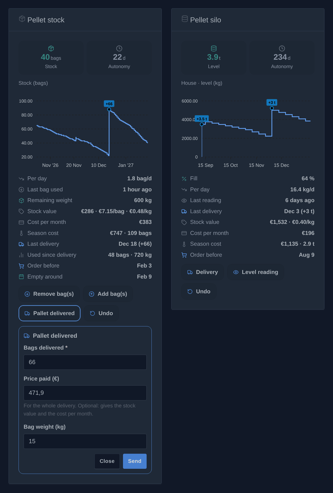
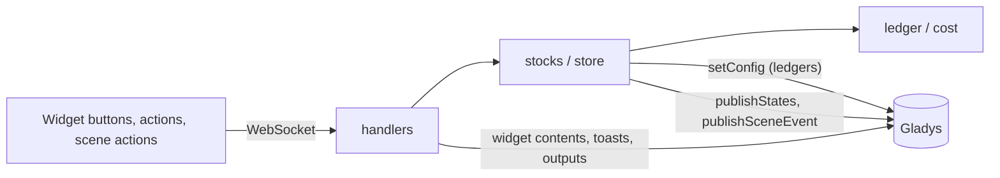
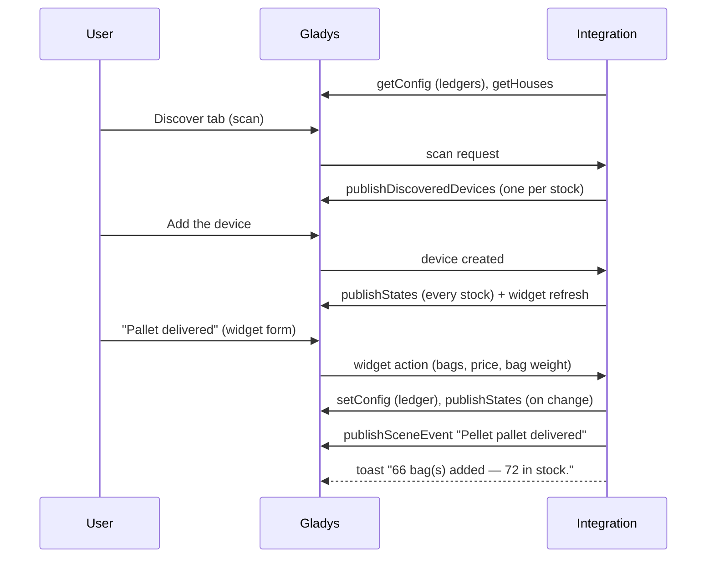
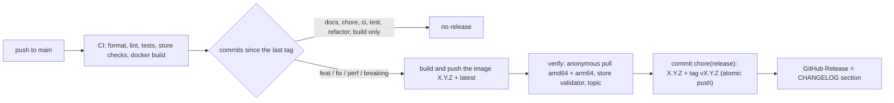

# Gladys Pellet Stock

**English** · [Français](README.fr.md) · [Deutsch](README.de.md) · [Español](README.es.md)

[](LICENSE)
[](https://github.com/William-De71/gladys-pellet-stock/releases)
[](https://github.com/William-De71/gladys-pellet-stock/actions/workflows/release.yml)
[](https://gladysassistant.com)

External [Gladys Assistant](https://gladysassistant.com) integration that tracks a **wood pellet stock**, in bags
or in a bulk silo, one per house: deliveries, consumption, average daily consumption, autonomy and heating cost,
with **dashboard widgets**, scene actions and triggers, built on `@gladysassistant/integration-sdk` 0.15.

No hardware and no cloud account: the integration keeps a ledger of movements and derives everything from it.





_Generated illustrations, not screenshots: the contents come from the integration's code, drawn like the Gladys widgets (dark mode). Left, the stock over time with its buttons, and the bags used per day with the buttons hidden; below, the "Pallet delivered" form and a silo._

User documentation: [English](docs/en.md) · [Français](docs/fr.md) · [Deutsch](docs/de.md) · [Español](docs/es.md).

## Contents

- [Features](#features)
- [Architecture](#architecture)
- [Installation](#installation)
- [Configuration](#configuration)
- [How the figures are computed](#how-the-figures-are-computed)
- [Development](#development)
- [Release and commit convention](#release-and-commit-convention)
- [Troubleshooting](#troubleshooting)
- [Contributing](#contributing)
- [License](#license)

## Features

### Dashboard widgets

**"Pellet stock"** (bags):

- **Tiles**: the stock in bags (green, orange under the low-stock threshold, red at zero) and the autonomy in days.
- **Chart**, picked per widget: the **stock over time** (step line, deliveries marked) or the **bags used per day**
  (bars; weekly over one year). Period: 1 month, 3 months or 1 year.
- **Status rows**: bags per day, last bag used ("2 hours ago"), remaining weight, stock value with the price per bag
  and per kg, cost per month and season cost (once a price is known), last delivery and bags used since, the date to
  order by and the estimated empty date.
- **Buttons**: **Remove bag(s)** (a form for the bags), **Add bag(s)** (the bags and the price per bag),
  **Pallet delivered** (the bags, the price paid and the bag weight) and **Undo**. They can be hidden per widget,
  for a read-only wall display.

**"Pellet silo"** (bulk): level, autonomy, level or kg-per-day chart, fill, last reading, value and price per kg,
season cost, order date; **Delivery**, **Level reading** (in kg or in % of the capacity) and **Undo**.

### Devices

A virtual device per stock, offered on the Discover tab (optional), every feature read-only with history:

| Device                 | Feature         | Category / type                         | Unit / bounds |
| ---------------------- | --------------- | --------------------------------------- | ------------- |
| Pellet stock (– House) | Pellet stock    | `counter-sensor` / `integer`            | 0–10,000 bags |
|                        | Pellet autonomy | `duration` / `integer`                  | days, 0–3,650 |
| Pellet silo – House    | Silo level (kg) | `counter-sensor` / `integer`            | 0–100,000 kg  |
|                        | Silo fill       | `level-sensor` / `liquid-level-percent` | %, 0–100      |
|                        | Silo autonomy   | `duration` / `integer`                  | days, 0–3,650 |

External ids: `ext:<selector>:pellet:stock` for the main stock, `ext:<selector>:pellet:<house>:<bags|bulk>`
for a stock added for a house. An unknown autonomy is never published as 0 (a 0 would fire the "empty" scenes).

### Several houses

**"Add a stock"** creates a stock for a house of Gladys (a stock of bags and a silo at most per house, named after
it), with its own history and its own device. **"Set up a stock"** gives a stock settings of its own, over the
defaults of the configuration; **"Attach a stock to a house"** attaches the main stock, or one added by name before
the houses, keeping its device and its history. The house names are read from Gladys (`location: true`; the
coordinates are not used). The widgets, the actions, the scene actions and the triggers all have a **Stock** field;
left empty, they use the main stock (triggers: every stock; silo actions: the only silo).

### Scenes

| Scene action                 | What it does                                                           |
| ---------------------------- | ---------------------------------------------------------------------- |
| **Use pellet bags**          | Removes bags: e.g. a Zigbee button next to the stove, one per press    |
| **Add pellet bags**          | Adds bags bought on their own, or a delivery when "Delivery" is ticked |
| **Correct the pellet stock** | Sets the stock to the bags counted                                     |
| **Read the pellet stock**    | Changes nothing: the figures, the type, the unit and the season cost   |
| **Record a silo delivery**   | Adds the kg delivered to a silo                                        |
| **Read the silo level**      | Sets the level of a silo, in kg or in %: a level sensor can feed it    |

Every action returns the **stock**, the **autonomy**, the **daily rate**, the **days before ordering** and (bags)
the **remaining weight**; a figure still unknown is left out, never sent as 0.

| Scene trigger               | Fires when                                                      |
| --------------------------- | --------------------------------------------------------------- |
| **Pellet stock low**        | The stock crosses the low-stock threshold (once, not every bag) |
| **Pellet stock empty**      | The last bag is used                                            |
| **Pellet pallet delivered** | A delivery of several bags is recorded                          |

The triggers carry the same figures as scene variables. Example: **Pellet stock low** → send a message
"`{{triggerEvent.data.bags_left}}` bags left, time to order". Following the SDK "no loop" rule, a delivery added by
a scene never fires "Pellet pallet delivered". The bag triggers leave the silos out: use the silo device.

### Configuration actions

Correct the stock, record a delivery or a consumption of any size, undo the last operation, **analyze the cost** of
a period (first in, first out), add, attach, set up or remove a stock.

### Languages

English, French, German and Spanish: manifest, runtime messages, widgets and user docs. Gladys gives the language
to the widgets only; the device names offered on the Discover tab follow the **Language of the device names**
setting (English by default).

## Architecture




From the Discover tab to a state, and a widget button:



Every hour, the autonomy (which drifts with time) is published again when it changed, and the house names are read
again. The integration is local only (`transports: ["local"]`): it talks to nothing but Gladys.

## Installation

From Gladys: **Integrations → store → Pellet Stock → Install**. Then follow the [user documentation](docs/en.md):
check the bag weight and the bags per pallet, run **"Correct the stock"**, add the **"Pellet stock"** widget to a
dashboard and, optionally, the device from the **Discover** tab.

Docker image: `ghcr.io/william-de71/gladys-pellet-stock`, multi-arch (amd64/arm64), non-root, read-only rootfs,
OCI labels and the manifest as the `io.gladysassistant.manifest` label.

## Configuration

| Key                     | Type     | Default | Used for                                                                           |
| ----------------------- | -------- | ------- | ---------------------------------------------------------------------------------- |
| `language`              | `select` | `en`    | The names of the devices offered on the Discover tab (`en`, `fr`, `de`, `es`)      |
| `bag_weight`            | `number` | 15      | The remaining weight and the weight used (kg)                                      |
| `pallet_size`           | `number` | 66      | What the "Pallet delivered" button adds                                            |
| `low_stock_threshold`   | `number` | 10      | The orange stock, the reminder, the order date, the trigger (bags)                 |
| `consumption_window`    | `number` | 14      | The days the average consumption is computed over                                  |
| `pallet_price`          | `number` | —       | Optional: stock value and cost per month, until a delivery is entered with a price |
| `bulk_capacity`         | `number` | —       | Silo: the fill rate, and the level read in %                                       |
| `bulk_low_threshold`    | `number` | 500     | Silo: the orange level and the reminder (kg)                                       |
| `bulk_delivery_default` | `number` | 3000    | Silo: pre-fills the "Delivery" form (kg)                                           |
| `bulk_tonne_price`      | `number` | —       | Silo: optional price per tonne, until a delivery is entered with a price           |
| `bulk_reading_unit`     | `select` | `kg`    | Silo: the "Level reading" form asks in `kg` or in `percent`                        |

These are the defaults of every stock: "Set up a stock" overrides them for one stock.

Each stock's ledger (last 2,000 movements; beyond, the oldest ones are compacted into an `opening` movement that
keeps the lots still in stock) is stored through `setConfig()`, under keys outside the `config_schema`
(`stock_ledger` for the main stock, a random `stock_ledger_<id>` for the others, `stocks` for their list, houses and
settings). It lives in the Gladys database: it is part of the Gladys backups and survives a container rebuild.

## How the figures are computed

- A **downward correction** of the stock counts as consumption: counting the stock every other week is enough to
  get a consumption rate. On the consumption chart, those bags land on the day of the recount.
- The **daily consumption** is averaged over the last _N_ days (14 by default), or over the known history when it
  is shorter. Under one day of history it stays unknown rather than extrapolating a single tap.
- The **autonomy** is the stock divided by that rate, and the **order date** is when the stock reaches the
  threshold at that rate. Without any consumption in the window (summer), both are unknown: shown as a dash, never
  published as 0.
- The **cost** is first in, first out: each delivery is a lot at the price paid for it (or the last price per bag
  known), each bag used is taken from the oldest lot. The **season cost** row (season start set per widget) and the
  **"Analyze the cost"** action add up the bags used over a period at the price of their lot; the remaining weight
  follows the bag weight of each lot. Bags without any price are told apart.
- Only **deliveries** count as deliveries (chart markers, "last delivery", "used since", the trigger): "Pallet
  delivered", "Record a delivery", a silo delivery. Bags added with "Add bag(s)", however many, are a purchase.

## Development

```bash
npm ci
npm run format:check
npm run lint
npm test
npx github:GladysAssistant/integration-store . --skip-image-check
docker build -t gladys-pellet-stock .
```

Node 22 or later. The tests (`node --test`) never touch the network. `DEBUG=gladys-integration-sdk` makes the SDK
validate every widget content against the core vocabulary and budget, and log what the core would drop.

- `test/structure.test.js` compares the device external ids, the feature fields the Discover tab compares and every
  key of the manifest with `test/fixtures/discovery.baseline.json`: existing users never have to recreate a device;
- `test/i18n.test.js` checks the four languages (manifest, runtime texts, docs, READMEs) and validates the widget
  contents in each;
- `test/release.test.js` covers the release script (version, changelog, bump).

`docs/illustrations/render.sh` regenerates the widget illustrations of `docs/assets/` in the four languages, from
the integration's code, drawn like the Gladys front (Chrome or Chromium, ImageMagick and Pillow needed).

| Path                 | Role                                                           |
| -------------------- | -------------------------------------------------------------- |
| `index.js`           | Entry point: lifecycle, hourly refresh                         |
| `src/handlers.js`    | Actions, scene actions, widgets and discovery handlers         |
| `src/stocks.js`      | The stocks: the main one and the added ones (houses, settings) |
| `src/store.js`       | One stock: persistence, device states, scene triggers          |
| `src/ledger.js`      | The ledger and every figure derived from it (pure functions)   |
| `src/cost.js`        | First in, first out cost                                       |
| `src/widget.js`      | The "Pellet stock" widget content                              |
| `src/silo-widget.js` | The "Pellet silo" widget content                               |
| `src/scene.js`       | Scene action outputs and trigger detection                     |
| `src/i18n.js`        | Runtime texts, en / fr / de / es                               |

`gladys_version` is `>=5.2.0` (widget action forms, house selects). Gladys 5.1 keeps version 1.2.0 of the
integration and does not receive the later versions.

## Release and commit convention

Releases are automatic. Every push to `main` runs the Release workflow:



- Commits and PR titles follow [Conventional Commits](https://www.conventionalcommits.org/), in English, written
  for the user: they become the changelog lines. `feat` → minor, `fix` / `perf` → patch, `!` or `BREAKING
CHANGE:` → major.
- `CHANGELOG.md` is generated at the release: never edit it by hand.
- The image is published and checked **before** the manifest on `main` announces the new version.
- Manual run (Actions → Release → Run workflow): `release-as` forces a version, `dry-run` only shows the version
  and the notes.
- A protected `main` would reject the release commit: allow GitHub Actions to bypass the rule, or use a GitHub
  App token.

## Troubleshooting

| Symptom                                        | Likely cause                                                                     |
| ---------------------------------------------- | -------------------------------------------------------------------------------- |
| Autonomy shown as a dash                       | less than one day of history, or no consumption in the window (summer)           |
| "Only N bag(s) in stock"                       | the recorded stock is lower than the bags removed: run "Correct the stock"       |
| The widget asks to pick a stock                | the stock was removed, or it is a silo in a bags widget (or the opposite)        |
| An added stock is missing from the widget list | its device was not added from the Discover tab yet                               |
| Device names in English                        | set **Language of the device names**, then scan again on the Discover tab        |
| The buttons add one bag without a form         | the Gladys version has no widget action forms (5.2.0 or later needed)            |
| The update is not offered                      | Gladys older than 5.2.0, or the store has not indexed the version yet (same day) |

Detailed logs: set the environment variable `DEBUG=gladys-integration-sdk` on the container.

## Contributing

Issues and pull requests are welcome: bug reports with the Gladys version, the integration version and the logs
([issue templates](.github/ISSUE_TEMPLATE)). Feedback on the
[Gladys forum thread](https://community.gladysassistant.com/t/integration-externe-stock-pellets/10907) too.
Security problems: see [SECURITY.md](SECURITY.md).

## License

[Apache-2.0](LICENSE) — see [NOTICE](NOTICE).
